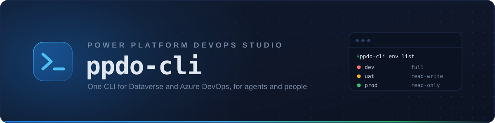
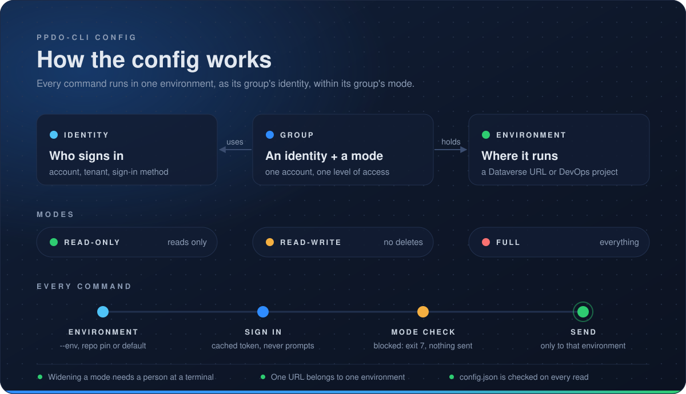

[](https://www.npmjs.com/package/@ppdostudio/ppdo-cli)
[](https://www.npmjs.com/package/@ppdostudio/ppdo-cli)
[](https://nodejs.org/)
[](https://packagephobia.com/result?p=%40ppdostudio%2Fppdo-cli)
[](https://github.com/PPDOStudio/ppdo-cli-release/blob/main/LICENSE)

# ppdo-cli

One CLI for **Dataverse** and **Azure DevOps**, built for coding agents and the people who work with them, from [Power Platform DevOps Studio](https://github.com/dylanhaskins/PowerPlatform-DevOpsStudio-Releases). You sign in once, outside any agent. Claude Code, GitHub Copilot and your own scripts then run the same commands and get the same JSON.

```
ppdo-cli dv api GET accounts --param '$select=name' --param '$top=5'
ppdo-cli ado api GET {project}/_apis/build/builds --param '$top=5'
ppdo-cli dv solution unpack MySolution.zip --folder solutions/MySolution
ppdo-cli whoami --check
```

> **Beta.** Commands, options and output may change between beta releases. The command is `ppdo-cli` for now, so that it doesn't clash with the `ppdo` PowerShell module.

## Install

You need Node.js 22.12 or later (Node 24 LTS recommended).

Install it globally from npm, where it is `@ppdostudio/ppdo-cli`. While ppdo-cli is in beta, name the `beta` tag:

```
npm install -g @ppdostudio/ppdo-cli@beta
ppdo-cli --version
```

Or run it without installing: `npx @ppdostudio/ppdo-cli@beta --help`.

Then install the agent skills (see [Agent skills](#agent-skills)), for example `ppdo-cli skills install --target claude`.

- **Update:** `npm install -g @ppdostudio/ppdo-cli@beta` again replaces the installed version.
- **Uninstall:** `npm uninstall -g @ppdostudio/ppdo-cli`. The config and token caches stay in their folders (see [Configuration files](#configuration-files)).

Each release is also on [GitHub](https://github.com/PPDOStudio/ppdo-cli-release/releases), as `ppdostudio-ppdo-cli-<version>.tgz` with its checksum in `SHA256SUMS`. Install a downloaded file with `npm install -g ./ppdostudio-ppdo-cli-<version>.tgz`.

Commands with a cached token load no sign-in code, so they start fast.

## Set up

- An **identity** is one account in one tenant.
- A **group** holds an identity and a mode: how much agents may change.
- An **environment** is one Dataverse URL or one DevOps project. It belongs to exactly one group, and gets its account and mode from there.



```
ppdo-cli identity add work --tenant contoso.onmicrosoft.com --username you@contoso.com --method browser
ppdo-cli group add contoso-dev  --identity work --mode full         # read, write, delete
ppdo-cli group add contoso-test --identity work --mode read-write
ppdo-cli group add contoso-prod --identity work                     # read-only
ppdo-cli env add dev  --in contoso-dev  --dataverse https://contoso-dev.crm.dynamics.com
ppdo-cli env add uat  --in contoso-test --dataverse https://contoso-uat.crm.dynamics.com
ppdo-cli env add prod --in contoso-prod --dataverse https://contoso.crm.dynamics.com
ppdo-cli env add platform --in contoso-dev --devops-org contoso --devops-project platform
ppdo-cli auth login work
ppdo-cli whoami --check
```

`ppdo-cli group discover <group>` lists every Dataverse environment the group's account can reach, and `--add <name>` adds them.

Commands use each service's default environment (`ppdo-cli env use <name>`), or `--env <name>`. To read from several at once, pass `--env dev,uat` or `--group contoso-test` to any read command. You get one labelled result per environment.

Different accounts for different services work too: put each in its own group. `ppdo-cli env pin dev platform` writes a `.ppdo-cli.json` at the root of a git repo, so every agent working there uses those environments.

Sign-in methods: `browser`, `broker` (Windows single sign-on), `device_code`, `az_cli` and `spn` (a service principal: `--client-id` with `--secret-env <VAR>` or `--certificate <pem|pfx>`). Tokens are cached per identity, encrypted with DPAPI on Windows. Commands never prompt for a sign-in: they exit with code 3 and print the `ppdo-cli auth login` command to run.

A `browser` sign-in opens a ppdo-cli page with a sign-in ID, such as `K7Q4-MD2X`, in its address, tab title and colour. The terminal prints the same ID, so with several sign-ins open at once you can tell which tab belongs to which.

### Configuration files

The `identity`, `group` and `env` commands write these files for you. Use the commands where you can: they check the rules below, and they ask a person at a terminal before anything gains a wider mode. The files are plain JSON, so you can also read or edit them by hand. Agents are told never to edit them.

| File | Where | What it holds |
|---|---|---|
| `config.json` | `%APPDATA%\ppdo-cli\` (Linux/macOS: `$XDG_CONFIG_HOME/ppdo-cli/`, default `~/.config/ppdo-cli/`) | identities, groups, environments, defaults |
| `.ppdo-cli.json` | the root of a git repo | the environments to use in that repo (`ppdo-cli env pin`) |
| `tokens.<identity>.bin`, `msal.<identity>.bin` | `%LOCALAPPDATA%\ppdo-cli\` (Linux/macOS: `$XDG_STATE_HOME/ppdo-cli/`, default `~/.local/state/ppdo-cli/`) | cached tokens and sign-in state, per identity, encrypted with DPAPI on Windows |

`PPDEVOPS_CONFIG_DIR` and `PPDEVOPS_STATE_DIR` move the two folders, for example to keep a test setup apart from your own.

ppdo-cli writes `config.json` with two-space indents and its keys always in the order shown below, so a change touches only the lines it needs. Fields that aren't set are left out.

A `config.json` with one identity of each kind, three groups and four environments:

```json
{
  "current-dataverse": "dev",
  "current-devops": "platform",
  "output": "json",
  "identities": {
    "work": {
      "tenant": "contoso.onmicrosoft.com",
      "username": "you@contoso.com",
      "method": "browser"
    },
    "work-sso": {
      "tenant": "contoso.onmicrosoft.com",
      "username": "you@contoso.com",
      "method": "broker"
    },
    "az": {
      "tenant": "contoso.onmicrosoft.com",
      "username": "you@contoso.com",
      "method": "az_cli",
      "config_dir": "C:/Users/you/.azure-contoso"
    },
    "ci": {
      "tenant": "contoso.onmicrosoft.com",
      "method": "spn",
      "client_id": "00000000-0000-0000-0000-000000000001",
      "secret_env": "CONTOSO_SP_SECRET"
    },
    "ci-cert": {
      "tenant": "contoso.onmicrosoft.com",
      "method": "spn",
      "client_id": "00000000-0000-0000-0000-000000000001",
      "certificate": "C:/certs/contoso-sp.pem"
    }
  },
  "groups": {
    "contoso-dev": {
      "identity": "work",
      "mode": "full",
      "environments": {
        "dev": {
          "dataverse": "https://contoso-dev.crm.dynamics.com"
        },
        "platform": {
          "devops": "contoso/platform"
        }
      }
    },
    "contoso-test": {
      "identity": "work",
      "mode": "read-write",
      "environments": {
        "uat": {
          "dataverse": "https://contoso-uat.crm.dynamics.com"
        }
      }
    },
    "contoso-prod": {
      "identity": "ci",
      "mode": "read-only",
      "environments": {
        "prod": {
          "dataverse": "https://contoso.crm.dynamics.com"
        }
      }
    }
  }
}
```

The five identities:
- `work` is you, signing in with a browser.
- `work-sso` is you, through Windows single sign-on.
- `az` is whatever account `az login` signed in to its own `config_dir`.
- `ci` is a service principal with a client secret.
- `ci-cert` is the same service principal with a certificate.

A JSON schema for the file ships with the package as `schema/ppdo-cli.schema.json` (after a global install, under the folder `npm root -g` prints, in `@ppdostudio/ppdo-cli/schema/`). To get completion and checks in an editor, add `"$schema"` with a path to it as the first key. ppdo-cli keeps that key when it rewrites the file, and never adds one itself.

**Top level**

| Key | Meaning |
|---|---|
| `current-dataverse`, `current-devops` | The default environment for each service, by name. Set with `ppdo-cli env use <name>`. |
| `output` | The default output format: `json`, `ndjson`, `table` or `tsv`. `-o` and `PPDEVOPS_OUTPUT` win over it. |
| `$schema` | Optional, for editors (see above). |

**`identities.<name>`**: one account in one tenant.

| Key | Meaning |
|---|---|
| `tenant` | Entra tenant id or domain. Required. |
| `method` | `browser` (default), `broker` (Windows single sign-on), `device_code`, `az_cli` or `spn`. |
| `username` | The account to sign in as (UPN). Required for `browser`, `broker` and `device_code`; a sign-in as anyone else is refused. |
| `client_id` | The app (client) id. For `spn`, the service principal's id. For the other methods it defaults to the Azure CLI's public client; set it only to sign in through your own app registration. |
| `config_dir` | `az_cli` only: the `AZURE_CONFIG_DIR` to use, so one identity can have its own `az login`. `~` is expanded when the command writes it. |
| `secret_env` | `spn` only: the name of the environment variable that holds the client secret. The secret itself is never stored. |
| `certificate` | `spn` only, instead of `secret_env`: a PEM file with the private key and the certificate, or a PFX/P12 file without a password. |

**`groups.<name>`**: an account and how much agents may change.

| Key | Meaning |
|---|---|
| `identity` | The identity every environment in the group uses. Must name an identity above. |
| `mode` | `read-only` (default), `read-write` or `full`. See [Safety](#safety). |
| `environments` | The group's environments, by name (below). |

**`groups.<group>.environments.<name>`**: one Dataverse environment or one DevOps project. Exactly one of:

| Key | Meaning |
|---|---|
| `dataverse` | The environment URL, for example `https://contoso.crm.dynamics.com`. |
| `devops` | `<organization>/<project>`, for example `contoso/platform`. |

**Rules.** The commands refuse any change that breaks these, and ppdo-cli checks them again every time it reads the file, so a mistake made by hand stops every command with exit 2 and names the file to fix:
- An environment name is used once, in one group only.
- A Dataverse URL or DevOps project belongs to one environment only (URLs compare without case), so it always has one account and one mode. To change its group, use `ppdo-cli env move`.
- Every environment has `dataverse` or `devops`.
- `mode` and `method` are one of the values above. A typo such as `Full` is refused, not read as `read-only`.

A group whose `identity` names an identity that isn't in the file is still read: commands that use it stop with "no identity named …". Add the identity again with `ppdo-cli identity add` (for a writable group, that needs a person at a terminal).

**`.ppdo-cli.json`** pins environments for one repo, by name. ppdo-cli looks for it from the current folder up to the git root (outside a git repo, only in the current folder). It can also hold a `$schema`, which `env pin` keeps:

```json
{
  "dataverse": "dev",
  "devops": "platform"
}
```

**Which environment, identity and format a command uses**, first match wins:

| What | Order |
|---|---|
| Environment | `--env` → `PPDEVOPS_DATAVERSE` / `PPDEVOPS_DEVOPS` → `.ppdo-cli.json` → `current-dataverse` / `current-devops` |
| Identity | `--identity` → `PPDEVOPS_IDENTITY` → the environment's group |
| Output format | `-o` → `PPDEVOPS_OUTPUT` → `output` in `config.json` → `json` |

### Running as an app (pipelines and one-offs)

`dv` and `ado` commands can run as a service principal with no config at all. Only `--client-id` turns this on; no environment variable does. The secret comes from `PPDEVOPS_CLIENT_SECRET` (at a terminal, ppdo-cli asks for it when that isn't set), or pass `--certificate <pem|pfx>`. `--env` takes a name or a URL. The mode is `--mode`, `read-only` by default. Nothing is saved: no config, no token cache.

```
ppdo-cli dv api GET WhoAmI --env https://contoso-uat.crm.dynamics.com \
  --tenant contoso.onmicrosoft.com --client-id <app-id>
```

In Azure DevOps, map the secret variable into the step: `env: { PPDEVOPS_CLIENT_SECRET: $(clientSecret) }`. The app needs to be an application user (with a security role) in each Dataverse environment, and a user in the DevOps organization.

## Safety

Each group has a mode (a command run as an app takes its mode from `--mode` instead):

- `read-only`: reads, plus POSTs that only read (a `$batch` of GETs, solution export, WIQL).
- `read-write`: everything except deletes.
- `full`: everything.

A blocked request exits with code 7. `--dry-run` shows the request without sending it. Tokens are only ever sent to the environment's own host or organization, and are dropped on a redirect to anywhere else.

Widening what agents may change needs a person at a terminal. That means raising a group's mode, adding or moving an environment into a writable group, or pointing a writable environment or its group's identity somewhere new. Without a terminal, the command exits 7. An environment can't be in two groups, so a read-only production environment can't also be reached through a writable group.

## Output and errors

- stdout carries JSON only (`-o ndjson|table|tsv` for other formats, or `PPDEVOPS_OUTPUT`). JSON is ASCII-escaped, so it survives any console code page.
- Errors are one JSON object on stderr: `{"error": "...", "hint": "...", ...}`.
- `-v` logs each request to stderr with secrets and tokens redacted. `-q` hides notices.

Exit codes:

| Code | Meaning |
|---|---|
| 0 | ok |
| 1 | error |
| 2 | usage |
| 3 | auth |
| 4 | not found |
| 5 | throttled |
| 6 | conflict |
| 7 | blocked by mode |
| 8 | forbidden |
| 130 | interrupted |

## Commands

`ppdo-cli commands` lists every command with its class: R (read), W (write), D (delete), M (depends on the HTTP method) or L (local only). Each command's `--help` has examples.

In PowerShell, quote values that contain commas, such as `--env 'dev,uat'` or `--select 'name,accountnumber'`. Unquoted, PowerShell passes them on as separate words.

| Command | What it does |
|---|---|
| `identity`, `group`, `env` | Set up accounts, groups and environments (see [Set up](#set-up)). |
| `auth login \| logout \| status \| token` | Sign in, sign out, see cached tokens, or print a token for scripts (`--show` to print to a terminal). |
| `whoami [--check]` | Which environment, mode and account each service resolves to; `--check` calls each service to confirm. |
| `dv api <method> <path>` | Any Dataverse Web API request, with auth, retries, paging (`--paginate`), errors and modes handled. |
| `dv query \| get \| create \| update \| delete` | Rows by OData options or FetchXML, or by id or alternate key; `--bypass-plugins` on writes (full mode only). |
| `dv batch \| upsert` | NDJSON requests as `$batch` (optionally atomic changesets), or many rows created or updated by key, with a result per row. |
| `dv associate \| disassociate` | Link or unlink two records through a lookup or relationship. |
| `dv fn \| action <name>` | Call a function (GET) or action (POST), with parameters typed for you. |
| `dv history <entityset> <id>` | Who changed a record or one column, and when. |
| `dv metadata list \| get \| attribute \| optionset \| create ...` | Compact table, column and choice definitions; create tables, columns, choices and keys. |
| `dv solution list \| get \| components \| dependencies \| history` | Inspect solutions, their components, missing dependencies and past operations. |
| `dv solution export \| import \| import-results \| publish` | Export (`--both`, `--unpack`), import (`--async`, `--holding`, `--upgrade`, `--settings`, `--activate-*`), see why an import failed, publish. |
| `dv solution create \| update \| patch \| add-component \| remove-component \| promote` | The solution lifecycle without pac; `dv publisher list \| create` for publishers. |
| `dv component ... \| dependency list` | A component's layers, dependencies, unpublished changes and names; dependency rows for solutions or one component. |
| `dv envvar \| connref \| connection` | Environment variables and connection references (with typed `set`), and the connections available. |
| `dv workflow \| plugin \| job` | Flows and processes (on/off, runs, swap-connref), plugin registrations, traces and stats, and system jobs. |
| `dv org \| setting \| team \| role \| user \| access` | Environment details and settings, security roles and privileges, and why someone can see a record. |
| `dv view \| form \| webresource` | Edit views and forms as XML files and push web resources from files. |
| `dv solution unpack <file.zip>` | Unpack a solution into a source folder without pac. The layout and bytes match `pac solution unpack`, only changed files are written, and `--check` exits 6 when the folder differs. |
| `dv solution pack <folder> --save <file.zip>` | Pack a source folder into a solution zip without pac, with the same bytes every time. A `.cdsproj` folder builds its PCF and plug-in references first; `--map` reads files from a mapping file. |
| `dv solution clone <uniquename>` | Export a solution (unmanaged and managed together) into a new `.cdsproj` project with the source in `src/`. |
| `dv solution sync [folder]` | Re-export the folder's solution and write only what changed, deleting files of removed components; `--check` exits 6 when the folder is out of date. |
| `ado api <method> <path>` | Any Azure DevOps REST request; `{project}` is replaced with the environment's project, and `--host` reaches the other DevOps hosts. |
| `ado project list`, `ado repo list \| get \| file \| tree \| branches \| commits \| diff \| policies` | Projects and Git repositories: a file at a branch, tag or commit, commit history, a unified diff between two refs (`--stat` for the file list), and branch policies. |
| `ado pipeline list \| get \| run \| stages`, `ado run list \| get \| logs \| retry \| cancel` | Pipelines and runs: queue a run (`--wait`, `--skip-stage`, `--only-stage`), its stages and errors, step logs (`--failed-only`, `--save`), and re-running failed stages. |
| `ado pr list \| get \| diff \| checks \| threads \| create \| update \| comment \| resolve \| link \| auto-complete \| complete` | Pull requests: create, review the diff and policy checks, comment and resolve threads, link work items, and complete without ever bypassing a policy. |
| `ado wi get \| query \| queries \| create \| update \| comment \| comments \| react \| tags \| fields \| attachments \| link` | Work items: WIQL and saved queries, create and update with Markdown long-text fields, tags, comments and reactions, a type's fields, attachments, and links to PRs and commits. |
| `ado user get`, `ado vargroup list \| get \| create \| set`, `ado environment list \| create \| checks \| permit`, `ado pool list \| agents \| usage` | Users, variable groups (secret values never shown), pipeline environments with their approvals and checks, and agent pools with how long jobs waited. |
| `graph group get \| search` | Entra groups and their members, read-only: every request is a GET to Microsoft Graph whatever the mode. |
| `skills install \| uninstall \| list` | Install the agent skills into Claude Code or GitHub Copilot. |

Deployment commands, which replace the Studio runners, are coming next.

## Agent skills

```
ppdo-cli skills install --target claude        # ~/.claude/skills
ppdo-cli skills install --target copilot --scope repo
ppdo-cli skills install --target claude --link # link instead of copy
```

`--link` (a junction on Windows, a symlink elsewhere) suits a local build: the agents always see the skills in your clone. `ppdo-cli skills uninstall` removes only the copies or links ppdo-cli made.

The bundled skills are `ppdo-cli` (load first: accounts, modes, exit codes, output), `ppdo-cli-dataverse` (data, metadata, solutions and source folders, diagnosis) and `ppdo-cli-devops` (repos, pull requests, work items, pipelines, failed runs). Together they list every `dv`, `ado` and `graph` command with all of its options.

## License

Free to use under the ppdo-cli Free Use Licence. Copyright (c) 2026 Dylan Haskins and Ryan James. All rights reserved. See [LICENSE](https://github.com/PPDOStudio/ppdo-cli-release/blob/main/LICENSE).

ppdo-cli bundles open source packages under their own licences. See [THIRD-PARTY-NOTICES](https://github.com/PPDOStudio/ppdo-cli-release/blob/main/THIRD-PARTY-NOTICES).
