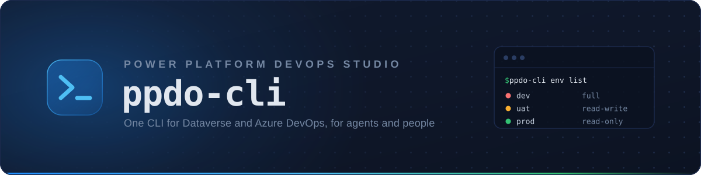
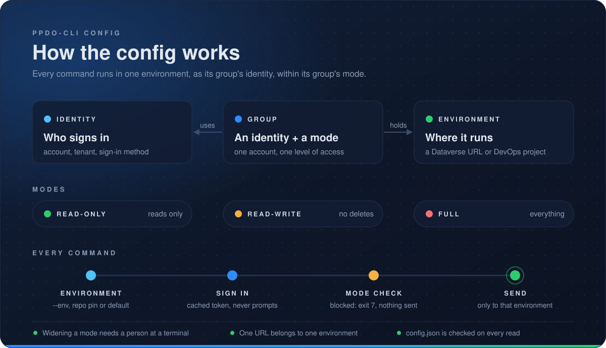

[](https://www.npmjs.com/package/@ppdostudio/ppdo-cli)
[](https://www.npmjs.com/package/@ppdostudio/ppdo-cli)
[](https://nodejs.org/)
[](https://packagephobia.com/result?p=%40ppdostudio%2Fppdo-cli)
[](https://github.com/PPDOStudio/ppdo-cli-release/blob/main/LICENSE)

# ppdo-cli

One CLI for **Dataverse** and **Azure DevOps**, plus new repositories on **GitHub** or Azure DevOps, built for coding agents and the people who work with them, from [Power Platform DevOps Studio](https://github.com/dylanhaskins/PowerPlatform-DevOpsStudio-Releases). You sign in once, outside any agent. Claude Code, GitHub Copilot and your own scripts then run the same commands and get the same JSON.

```
ppdo-cli dv api GET accounts --param '$select=name' --param '$top=5'
ppdo-cli ado api GET {project}/_apis/build/builds --param '$top=5'
ppdo-cli dv solution unpack MySolution.zip --folder solutions/MySolution
ppdo-cli repo create ContosoPlatform --provider github --preview
ppdo-cli whoami --check
```

> **Beta.** Commands, options and output may change between beta releases. The command is `ppdo-cli` for now, so that it doesn't clash with the `ppdo` PowerShell module.

## Install

You need Node.js 22.12 or later (Node 24 LTS recommended).

Install it globally from npm, where it is `@ppdostudio/ppdo-cli`. While ppdo-cli is in beta, name the `beta` tag:

```
npm install -g @ppdostudio/ppdo-cli@beta
ppdo-cli --version
```

Or run it without installing: `npx @ppdostudio/ppdo-cli@beta --help`.

Then install the agent skills (see [Agent skills](#agent-skills)), for example `ppdo-cli skills install --target claude`.

- **Update:** `npm install -g @ppdostudio/ppdo-cli@beta` again replaces the installed version.
- **Uninstall:** `npm uninstall -g @ppdostudio/ppdo-cli`. The config and token caches stay in their folders (see [Configuration files](#configuration-files)).

Each release is also on [GitHub](https://github.com/PPDOStudio/ppdo-cli-release/releases), as `ppdostudio-ppdo-cli-<version>.tgz` with its checksum in `SHA256SUMS`. Install a downloaded file with `npm install -g ./ppdostudio-ppdo-cli-<version>.tgz`.

Commands with a cached token load no sign-in code, so they start fast.

## Set up

- An **identity** is one account in one tenant.
- A **group** holds an identity and a mode: how much agents may change.
- An **environment** is one Dataverse URL, one DevOps project or one GitHub owner. It belongs to exactly one group, and gets its account and mode from there.



```
ppdo-cli identity add work --tenant contoso.onmicrosoft.com --username you@contoso.com --method browser
ppdo-cli group add contoso-dev  --identity work --mode full         # read, write, delete
ppdo-cli group add contoso-test --identity work --mode read-write
ppdo-cli group add contoso-prod --identity work                     # read-only
ppdo-cli env add dev  --in contoso-dev  --dataverse https://contoso-dev.crm.dynamics.com
ppdo-cli env add uat  --in contoso-test --dataverse https://contoso-uat.crm.dynamics.com
ppdo-cli env add prod --in contoso-prod --dataverse https://contoso.crm.dynamics.com
ppdo-cli env add platform --in contoso-dev --devops-org contoso --devops-project platform
ppdo-cli auth login work
ppdo-cli whoami --check
```

`ppdo-cli group discover <group>` lists every Dataverse environment the group's account can reach, and `--add <name>` adds them.

Commands use each service's default environment (`ppdo-cli env use <name>`), or `--env <name>`. To read from several at once, pass `--env dev,uat` or `--group contoso-test` to any read command. You get one labelled result per environment.

Different accounts for different services work too: put each in its own group. `ppdo-cli env pin dev platform` writes a `.ppdo-cli.json` at the root of a git repo, so every agent working there uses those environments.

Sign-in methods: `browser`, `broker` (Windows single sign-on), `device_code`, `az_cli`, `spn` (a service principal: `--client-id` with `--secret-env <VAR>` or `--certificate <pem|pfx>`) `pat` (an Azure DevOps personal access token, see [below](#azure-devops-with-a-pat)) and `gh_cli` (the GitHub CLI's sign-in, see [GitHub](#github)). Tokens are cached per identity, encrypted with DPAPI on Windows. Commands never prompt for a sign-in: they exit with code 3 and print the `ppdo-cli auth login` command to run.

A `browser` sign-in opens a ppdo-cli page with a sign-in ID, such as `K7Q4-MD2X`, in its address, tab title and colour. The terminal prints the same ID, so with several sign-ins open at once you can tell which tab belongs to which.

### Azure DevOps with a PAT

Use a personal access token (PAT) only when an Entra sign-in to Azure DevOps isn't possible, for example on a device that Conditional Access blocks. A PAT lives for months, carries its own access, and skips the device checks that a sign-in gets. So ppdo-cli keeps it on a short leash:

- A `pat` identity is for **one** Azure DevOps organization. ppdo-cli sends the PAT to `https://dev.azure.com/<organization>/` only, and checks this on every request. A group that uses the identity can hold only DevOps environments of that organization. The PAT never reaches Dataverse or Graph.
- Only a person enters a PAT: at a terminal with hidden input, or, when an agent runs `auth login`, on ppdo-cli's PAT page in the browser. The page shows the organization it goes to and the environments that use it. The agent never sees the PAT, and changing a writable group's PAT identity needs a person too.
- Before ppdo-cli keeps a PAT, Azure DevOps must confirm it belongs to the identity's `--username`.
- No command shows it: not `auth token`, `auth status`, `whoami`, `--dry-run` or `-v`. Child processes (az, dotnet, the browser) don't get the variable that holds it.

```
ppdo-cli identity add ado --method pat --organization contoso --username you@contoso.com
ppdo-cli group add contoso-ado --identity ado --mode read-write
ppdo-cli env add platform --in contoso-ado --devops-org contoso --devops-project platform
ppdo-cli auth login ado --expires 2026-12-31     # paste the PAT (hidden input, or the browser page)
ppdo-cli whoami --check
```

Create the PAT in Azure DevOps (User settings → Personal access tokens) with:
- **Organization:** this one organization, not "All accessible organizations". ppdo-cli refuses a PAT that is already stored for an identity of another organization.
- **Scopes:** the fewest that your commands need, for example Code (Read) for repos and pull requests, Work Items (Read), Build (Read). Add the write scopes only for a writable group.
- **Expiration:** short. Pass the same date to `--expires`, and ppdo-cli warns a week before and stops when it expires.

**Where it is kept.** On Windows the PAT is encrypted with DPAPI in `pat.<identity>.bin`, and ppdo-cli refuses to store or read it without DPAPI. On macOS and Linux it is protected by file permissions only, so `auth login` asks you to agree first (type `yes`, or tick the box on the PAT page). DPAPI and file permissions both keep it from other users, not from other code running as you.

**Share a Windows credential.** Run `ppdo-cli identity update ado --pat-target <target>` at a terminal, with the target name of an existing or new Windows Credential Manager generic credential. For a PAT Manager credential, use the exact target from its organization configuration. No Copilot app or PAT Manager installation is required. The identity still names its organization and username; the group selects that identity. A person must confirm a new or changed target at a terminal. ppdo-cli verifies each new PAT value with Azure DevOps before using it. To rotate it from ppdo-cli, run `auth login <identity> --expires YYYY-MM-DD`: at a terminal, or, when an agent runs it, on the PAT page in the browser. When the optional PAT Manager configuration references that target, ppdo-cli also updates its declared expiry; the date must be today through 30 days from today. Do not rotate the same target concurrently. A shared target requires Windows and the optional `koffi` and `@azure/msal-node-extensions` dependencies.

**In a pipeline**, set `--pat-env <VAR>` on the identity instead, and map the PAT into that variable. ppdo-cli reads that variable only (never `AZURE_DEVOPS_EXT_PAT` or other ambient ones) and confirms each new value with Azure DevOps on its first use.

`ppdo-cli auth logout <identity>` deletes the CLI's PAT file. It does not delete a shared Credential Manager entry: remove that entry separately if needed. Revoke the PAT in Azure DevOps too: the command prints the link. A remaining shared entry can be verified and used again on the next command.

### GitHub

ppdo-cli reaches GitHub through your [GitHub CLI](https://cli.github.com) sign-in. A GitHub environment is an **owner**: your own account, or an organization you are a member of.

```
gh auth login --hostname github.com
ppdo-cli identity add octo --method gh_cli --username octocat
ppdo-cli group add github --identity octo --mode read-write
ppdo-cli env add contoso --in github --github contoso
ppdo-cli whoami --service gh --check
```

- A `gh_cli` identity is for github.com only. A group that uses it holds only GitHub environments, and a GitHub environment must be in such a group. GitHub Enterprise Server isn't supported yet.
- ppdo-cli reads the token from `gh auth token` when a command needs it, keeps it in memory for that run, and sends it to `https://api.github.com` only. It never stores, prints or passes it on. `--config-dir` sets the `GH_CONFIG_DIR` for an identity with its own `gh` sign-in.
- Before each command, GitHub must confirm that the sign-in is the identity's `--username`. After `gh auth switch` to another account, commands exit 3.
- ppdo-cli never signs in to GitHub. `ppdo-cli auth login` for a `gh_cli` identity only shows the `gh auth login` command to run.

### New repositories

`ppdo-cli repo create` makes a new repository and pushes its first commit, on GitHub (under the GitHub environment's owner) or in the existing project of a DevOps environment:

```
ppdo-cli repo create ContosoPlatform --provider github --preview
ppdo-cli repo create ContosoPlatform --provider github --path ./ContosoPlatform --branch main
ppdo-cli repo create ContosoPlatform --provider azure-devops --env platform
```

1. It checks Git, your Git author, the branch name, the folder (new or empty), the account, the owner or project, the name and the mode (`read-write` or `full`). `--preview` stops here and shows the plan; it changes nothing.
2. It creates an **empty** repository: no README, licence or ignore file, and no access grants. On GitHub it is private unless you pass `--public`. On Azure DevOps it has its project's visibility.
3. It initializes the folder on `--branch` (default `main`), commits only `README.md` and `.gitignore`, sets `origin` to the host's clone URL, pushes, and checks that the host's default branch is that commit.

Git pushes with your own Git credentials (for example Git Credential Manager, or `gh auth setup-git` for GitHub). ppdo-cli never puts a token in a remote URL, a Git setting or Git's environment, and never force-pushes.

An existing repository with the same name is a conflict (exit 6): ppdo-cli never takes one over. If a step fails after the repository exists, the output shows the steps done; fix the cause and run the same command again to continue from there. A receipt in ppdo-cli's state folder records each step, and ppdo-cli deletes it when the repository is done. ppdo-cli never deletes a repository.

### New projects

`ppdo-cli project init` turns a repository, such as one from `repo create`, into a Power Platform project in the lean native profile, which Power Platform DevOps Studio opens:

```
ppdo-cli project init --path ./ContosoPlatform --preview
ppdo-cli project init --path ./ContosoPlatform
```

It writes `AGENTS.md`, `.gitattributes`, `package.json` (which pins this ppdo-cli version), `.github/copilot-instructions.md`, `<Name>.json`, `<Name>.studio.json`, `Environments.json` and `deployPackages.json`, and adds missing lines to `.gitignore`. `<Name>` is the repository name from `origin` (GitHub or Azure DevOps), and the folder must have that name. `--base-branch` sets the branch PRs target; the default is the current branch.

It works offline and never overwrites a file: if a file exists with other content, it lists it (exit 6) and writes nothing. Running it again changes nothing. It stages and commits nothing, so you review the files and commit them yourself. Then add each solution from the development environment:

```
ppdo-cli project add-solution ContosoCore --path ./ContosoPlatform --publisher contoso --prefix con --env dev --preview
ppdo-cli project add-solution ContosoCore --path ./ContosoPlatform --publisher contoso --prefix con --env dev
```

`project add-solution` uses the solution if it exists, or creates it as an unmanaged solution of `--publisher` (with `--prefix`, it also creates that publisher if it doesn't exist). It clones the source into a top-level folder named after the solution and writes `<solution>.version`, the solution's entry in `<Name>.json` (with the environment URL) and its entry in `deployPackages.json`, as Studio's Add Solution does. Creating needs `read-write`; adding an existing solution needs only `read-only`. It stages and commits nothing.

### Building from an app spec

An app spec is a JSON file, kept in the project repository, that describes what a solution needs in Dataverse. It holds the data model (global choices, tables, columns, lookups, many-to-many relationships, alternate keys), the user interface (views, forms, charts, dashboards, model-driven apps, icons and web resources), security roles, environment variables, configuration and sample data, and the logic: plugins, plugin packages, Custom APIs and PCF controls built from their source projects, cloud flows with their connection references, and classic workflows, business rules and actions from their exported files. You (or an agent working from a design or from existing solutions) write the spec; ppdo-cli makes a development environment match it, and `spec plan` says exactly what differs.

```
ppdo-cli spec validate specs/ContosoCore.app.json
ppdo-cli spec preview specs/ContosoCore.app.json --open
ppdo-cli spec plan specs/ContosoCore.app.json --env dev
ppdo-cli spec apply specs/ContosoCore.app.json --env dev
ppdo-cli spec seed specs/ContosoCore.app.json --env dev
ppdo-cli dv solution sync ./ContosoCore
```

To start from existing solutions instead of a design, `spec from-solution` writes a spec from unpacked solution source:

```
ppdo-cli spec from-solution --project ./ContosoPlatform --solution ContosoApp --out specs/ContosoApp.app.json
```

It reads the solutions in the order of the project's `deployPackages.json` (or the folders you give, in order), so the spec is the state after the last one. `--solution` is the spec's own solution (pass the main one); an element another solution created first names that solution: a later solution's definition of a component wins, and a partial table adds to what came before. It writes `ContosoApp.gaps.json` next to the spec, with each part the spec cannot hold yet, and copies the icons the spec uses and the definitions of calculated and rollup columns (`formulas/`). A view or form is written with the structured fields when they give the same view or form again, and as raw XML otherwise; the gaps file lists those under `raw`. It works offline and never replaces a file with other content unless `--force`.

- `spec validate` works offline. It checks the shape, the names, the publisher prefix and every reference, and lists each problem with its JSON path (exit 2).
- `spec preview` shows the app the spec describes in your browser, in the look of Power Apps, without an environment or a sign-in: the site map, the views over the spec's `data` rows (filters and sort run in the page), and the main forms with their header, tabs, sections, sub-grids and timeline. It serves the page on `127.0.0.1` (`--port`, default a free port), prints the URL as JSON, and serves until Ctrl+C. The page reloads when you save the spec, and lists the problems of a spec that is not valid. It is a preview: dashboards, charts, quick create forms, raw XML, form scripts and PCF controls are not shown yet.
- `spec plan` reads the environment and prints one step per element: `create`, `update`, `ok` (already there) or `missing` (something it needs is not there, such as a lookup's target table). It changes no Dataverse data, but can run local builds.
- `spec apply` runs the plan in order (publisher, solution, icons, web resources, PCF controls, environment variables, connection references, choices, tables, columns, lookups, many-to-many relationships, keys, views, grid controls, forms, charts, dashboards, security roles, actions, plugins, Custom APIs, workflows and business rules, cloud flows, apps, configuration data), adds each component to the spec's unmanaged solution, and publishes the tables, dashboards and apps it changed (an imported PCF control is published at once). It creates a new table's columns, except lookups, in the same request as the table. It stops at the first failure; fix the cause and run it again, and it continues, because whatever exists is `ok`. Its output gives the seconds of each step, and of the read, the steps and the publish. It needs `read-write`. If the environment has no publisher with the spec's name and prefix, apply creates it, and then the unmanaged solution (version 1.0.0.0); it never changes a publisher or solution that exists, and the plan reports one that disagrees with the spec (another prefix, a managed solution, another publisher) as `missing`. Apply works only on the environment: run `project add-solution` to add the solution to a project, which uses the solution apply made.

**Web resources from source.** A spec can name source projects in `builds` and use their outputs in `webResources`. `spec plan` and `spec apply` build missing or stale outputs; `--no-build` requires an up-to-date cache and `--build` forces a build. `spec build <file> --out <folder>` creates a portable artifact; `--check` compares two builds. Use `--artifacts <folder>` on plan and apply to use that artifact without building. A dry run never builds: it requires a current cache or an artifact. For `npm`, `command` or explicit `output` builds, the build runs into an empty output folder, so every file in it is new output; the old files are moved aside and put back afterwards when the build did not replace them.

`spec from-solution` finds matching source projects in the solution folders or repeatable `--code-root <folder>` paths. Generated npm builds install from the project lock file before running its build script. It reports missing or ambiguous JavaScript sources as gaps instead of copying compiled exports. Matches and output paths are based on file names: review them against the build configuration. Manually named static files still deploy as given.

Only run builds from trusted source. Build commands run as your user, can change local files and access the network, and are not sandboxed. ppdo-cli removes its configured secret variables, not all other credentials or files. Portable artifacts require committed, matching source inputs; hashes detect changes but do not authenticate the artifact, and ignored files and build environments are not fully captured. `spec plan` changes no Dataverse data, but it runs these build commands when the cached outputs are stale: give `--no-build` for a spec you have not reviewed.

A short spec:

```json
{
  "specVersion": 1,
  "solution": { "uniqueName": "ContosoCore", "publisher": "contoso", "prefix": "con", "displayName": "Contoso Core", "publisherDisplayName": "Contoso" },
  "choices": [{ "name": "con_region", "displayName": "Region", "options": ["North", "South"] }],
  "tables": [
    {
      "name": "con_Project", "displayName": "Project", "plural": "Projects",
      "primaryName": { "name": "con_Name", "displayName": "Project Name" },
      "hasActivities": true, "hasNotes": true,
      "columns": [
        { "name": "con_Region", "type": "choice", "choice": "con_region", "displayName": "Region", "required": true },
        { "name": "con_Tags", "type": "choices", "options": ["Pilot", "Funded"], "displayName": "Tags" },
        { "name": "con_Site", "type": "url", "displayName": "Site" },
        { "name": "con_ClientId", "type": "lookup", "targets": ["account"], "displayName": "Client" }
      ],
      "keys": [{ "name": "con_ProjectNameKey", "columns": ["con_name"] }]
    },
    { "name": "contact", "existing": true, "columns": [{ "name": "con_Role", "type": "string", "displayName": "Project Role" }] }
  ],
  "relationships": [{ "name": "con_contact_con_project", "type": "many-to-many", "tables": ["contact", "con_project"] }],
  "views": [
    {
      "table": "con_project", "name": "Active Projects", "default": true,
      "columns": [{ "name": "con_name", "width": 250 }, "con_region", "con_clientid", "statecode"],
      "sort": ["con_name"], "filter": ["statecode eq Active", "con_region in North, South"]
    }
  ],
  "apps": [
    {
      "uniqueName": "con_Projects", "name": "Contoso Projects",
      "areas": [{ "label": "Work", "groups": [{ "label": "Projects", "items": ["con_project", { "table": "contact", "label": "People" }] }] }]
    }
  ]
}
```

What it covers:

- Column types `string`, `memo`, `email`, `url`, `phone`, `int`, `bigint`, `decimal`, `money`, `bool`, `date`, `datetime`, `choice`, `choices` (multi-select), `image`, `file`, `lookup` and `customer`. A lookup with more than one target is a polymorphic lookup; `cascadeDelete` (`RemoveLink`, `Cascade`, `Restrict`) sets what happens when the target row is deleted, `cascade` sets each cascade, and `relationship` names the relationship.
- Computed columns: a Power Fx `formula`, or the `calculated` or `rollup` definition (XAML) in a file next to the spec. Apply creates them after the columns they read, and updates a definition that differs.
- Column settings: date `behavior` (`dateOnly`, `userLocal`, `timeZoneIndependent`), text `format` (such as `textarea` and `richtext`), `required` (or `'recommended'`), `audit`, `searchable`, `secured`, `autoNumber`, a choice or bool `default`, bool `trueLabel` and `falseLabel`, and an option's `color` (`{ "label": "Done", "color": "#E7F5E7" }`, a `#RRGGBB` colour that the Power Apps grid and charts show); table `settings` such as `audit`, `changeTracking`, `quickCreate` and `duplicateDetection`; and a many-to-many relationship's `intersect` table name.
- Table and navigation icons: an SVG file next to the spec becomes a web resource in the solution and the icon of a table the spec creates, or of one app navigation item.
- Custom tables (with `hasActivities` and `hasNotes` for the timeline), custom activity tables (`"activity": true`), and new columns and keys on existing tables such as account and contact (`"existing": true`).
- Several solutions (`"specVersion": 2`): `solutions` lists more unmanaged solutions of the publisher, and any element can name one with `"solution"` (a column or key defaults to its table's). Apply creates each missing solution and builds each element into its own.
- Option values come from the publisher's option value prefix, unless an option gives its own `value`. For a publisher that apply creates, `solution.optionValuePrefix` sets it (10000-99999); without it, ppdo-cli derives it from the prefix, so it is the same in each environment.
- View filters are conditions that must all be true, `<column> <FetchXML operator> [value]`, where choice, status and yes/no values can be labels; `has <relationship>` keeps rows linked through a many-to-many relationship; `{ "or": [...] }` and `{ "and": [...] }` group conditions.
- A view can also have a `type` (a table's own `quickfind`, `lookup`, `associated`, `advancedfind`, `offline` or `copilot` view, which the spec replaces), an `id`, joins (`links`, whose columns show as `<alias>.<column>`), quick find columns (`find`), query columns it does not show (`select`), cells with `hidden`, `sortable` and `image`, and `layout` settings. For a view these cannot hold, give raw `fetchXml` and `layoutXml` instead (never both kinds). Dataverse refuses a Web API update of a quick find view with its search columns, so apply saves a `quickfind` view through an import of the spec's own solution (the same name, version and publisher), which takes some seconds per view.
- Forms (`forms`) of type main, quick create, quick view and card: a header of up to four columns (with the labels the form's fields give them, or their own), and tabs of sections in one to four columns, holding columns, sub-grids of related rows (through a lookup or a many-to-many relationship, with a view) and the timeline. A field or sub-grid can have a custom `control`: the Power Apps grid (`powerAppsGrid`, with parameters such as `EnableDropdownColor` to show option colours) or a PCF control, with its parameters; a table's `gridControl` is the control of all its views, and its `statusColors` colour its Status Reason options (Status itself cannot have colours). Tabs can have columns of their own widths; tabs, sections and fields can be hidden or show no label; a form can have an `id`, libraries and event handlers, and its order among the table's forms. For a form these cannot hold (navigation, forms for some security roles only), give raw `formXml`, with the spec's views, forms and charts named as `{{view:<table>:<name>}}`, `{{form:<table>:<type>:<name>}}` and `{{chart:<table>:<name>}}`.
- System charts (`charts`): a count of rows (or a sum, average, minimum or maximum of a column) grouped by one column, with an optional date grouping, as a column, bar, line, area, pie, doughnut or funnel chart, with the standard look or its own `presentationXml`.
- Dashboards (`dashboards`): rows of one to four components, each a chart over a view, or a list of a view (with more views to switch to), with their widths, heights and switches; or raw `formXml` for other controls.
- Sample data (`data`): blocks of rows per table, which `spec seed` upserts by their key columns, with choice labels, lookups by the target row's name, and many-to-many links. A rerun changes nothing, and seed never deletes.
- Web resources (`webResources`): files next to the spec (JavaScript, HTML, CSS, images, RESX and the rest), named `<prefix>_/<path>` or by their own name, which apply creates or updates and publishes.
- Environment variables (`environmentVariables`): definitions with their type, default and current value.
- Security roles (`roles`): roles in the root business unit with a privilege depth per table (one for all eight, or one each for create, read, write, delete, append, append to, assign and share) and other privileges by name. A role holds exactly the spec's privileges: apply adds, changes and removes privileges to match. `spec from-solution` writes the roles in the source.
- Plugins (`plugins`): plugin assemblies built from a `dotnet` build. The registration attributes on their classes give the plugin types, steps, images, workflow activities and Custom APIs, which apply registers as `dv plugin register` does, into the spec's solution. Apply never deletes: a registered step the code does not declare stops the plan, unless the entry sets `keepUndeclared`. A plugin package (`.nupkg`) that the build packs is uploaded, and the steps and Custom APIs of its assemblies are registered. `spec from-solution` writes an entry for each assembly or package whose C# project it finds.
- Cloud flows (`flows`) and connection references (`connectionReferences`): each flow from its definition JSON (an export's `Workflows/<name>-<id>.json`), with its id and on/off state. Apply creates or updates the flow and turns it on or off through the Web API; the plan compares the definition by content. Apply creates connection references but never binds a connection, and a flow that should be on needs its references bound. `spec from-solution` points each cloud flow at its exported definition.
- Classic processes (`processes`): workflows, business rules and actions, each from its exported `.xaml.data.xml` and `.xaml`. Apply creates or updates the process through the Web API with its settings and XAML, turning an active one off for the update and on again, as Dataverse requires; the plan compares the XAML, the settings and the state. Business process flows are not in the spec yet.
- Passthrough (`passthrough`): folders of an unpacked solution that the spec does not model, such as `CanvasApps`, `dvtablesearchs` (Dataverse search), `aiskillconfigs` or `duplicaterules`, as `{ source, folders, solution }`. Apply packs those folders into a small solution with the target solution's name, version and publisher and imports it; a table that a component names (such as a duplicate rule's table) comes with it unchanged, because Dataverse imports such components only with their table. The plan exports the target solution and compares each component's files. Folders the spec models, and code that must come from source (plugins, controls, web resources, plugin steps), cannot be passed through. `spec from-solution` writes one entry per solution for the folders it does not model.
- Organization settings (`settings`): `organization` gives columns of the environment's organization row (text, number, choice and yes/no columns, such as `isauditenabled` or `sessiontimeoutinmins`), and `environment` gives the environment value of each setting definition by unique name (as the maker portal's settings set it), optionally as `{ value, solution }`. Apply sets each one that differs through the Web API and never removes a value; the setting values go into the spec's solution, the organization row is not a solution component. `spec from-solution` writes the setting values the solutions carry.
- PCF controls (`controls`): every control a `pcf` build makes. Apply imports each new or changed control into the spec's solution and publishes it. The plan compares the control's version and its resources byte for byte; a changed control needs a higher version in `ControlManifest.Input.xml`. `spec from-solution` names the `.pcfproj` of each exported control it finds.
- Custom APIs (`customApis`): APIs the spec defines (binding, function or action, request parameters and response properties), each implemented by a plugin type of a spec plugin; apply registers them with that assembly. An API that the registration attributes also define is refused. `spec from-solution` writes the APIs that only the solution defines.
- Configuration data (`referenceData`): `dv data` folders that `spec plan` plans and `spec apply` imports after everything else (`--overlay <name>` or `--no-overlay` for a folder with overlays). `spec from-solution` lists each solution's `reference-data` folder, and gives the `dv data convert` command for CMT data.
- Model-driven apps (`apps`): a site map of areas, groups and items (a table, with an optional label, a spec dashboard, or a URL). The app holds the tables in its site map, the tables in its `tables` list, and the related tables of the spec forms' sub-grids. For a table with spec forms, views or charts, the app shows only those; a table with none shows all of its own. An app can also give its security `roles` (by name), its `settings`, and exact lists of its `views`, `forms` and `charts`. `spec apply` reports the app checker's warnings as `appIssues`.

**What apply changes.** It never deletes a component, never renames, and never changes a column's type. A security role gets exactly the spec's privileges, so apply removes privileges the spec does not give; a flow, workflow, business rule or action is turned on or off as the spec says, and an active process is turned off for an update and on again; organization settings are set as the spec gives them; passthrough folders are imported as they are; apply never prunes plugin steps (a registered step the code does not declare stops the plan) and never binds a connection. On the tables and columns the spec creates, it updates the settings the spec gives when they differ (`update` in the plan, with the fields). It never changes a choice, relationship or key that already exists, except to add the options the spec gives that it lacks, rename an option the spec gives with its own `value` and another label, and set the option colours the spec gives (the Web API cannot clear one): change those otherwise with `dv metadata` or the maker portal. Views, forms, charts, dashboards and apps are different: the spec owns each one it names, so apply creates it, or replaces its definition when it differs (`update` in the plan), and leaves those it does not name alone. Name a table's own default view, or its "Information" main form, to replace it.

On account, contact and other out-of-the-box tables, apply never edits a system form, and edits a system view only when the spec names it by `type` (its quick find, lookup or other system view). Give public views new names; an app that holds the table shows only the spec views. A spec main form there is a new form **copied** from the table's main form (a raw `formXml` form is not a copy) (`copyOf`, default the default main form), with the spec's header and tabs put in; `otherTabs` keeps, hides or removes the copied tabs the spec does not name. The copy keeps the original's scripts and events. A spec view, form, chart, dashboard or app with the name of a managed one is refused. An app's site map can name the Activities table (`activitypointer`), but the Web API cannot add that table to an app, so the app checker warns about it.

Use a development environment. The `ppdo-cli-build` agent skill has the full spec reference and the procedure for turning a design into a spec.

### Configuration files

The `identity`, `group` and `env` commands write these files for you. Use the commands where you can: they check the rules below, and they ask a person at a terminal before anything gains a wider mode. The files are plain JSON, so you can also read or edit them by hand. Agents are told never to edit them.

| File | Where | What it holds |
|---|---|---|
| `config.json` | `%APPDATA%\ppdo-cli\` (Linux/macOS: `$XDG_CONFIG_HOME/ppdo-cli/`, default `~/.config/ppdo-cli/`) | identities, groups, environments, defaults |
| `.ppdo-cli.json` | the root of a git repo | the environments to use in that repo (`ppdo-cli env pin`) |
| `tokens.<identity>.bin`, `msal.<identity>.bin` | `%LOCALAPPDATA%\ppdo-cli\` (Linux/macOS: `$XDG_STATE_HOME/ppdo-cli/`, default `~/.local/state/ppdo-cli/`) | cached tokens and sign-in state, per identity, encrypted with DPAPI on Windows |

`PPDEVOPS_CONFIG_DIR` and `PPDEVOPS_STATE_DIR` move the two folders, for example to keep a test setup apart from your own.

ppdo-cli writes `config.json` with two-space indents and its keys always in the order shown below, so a change touches only the lines it needs. Fields that aren't set are left out.

A `config.json` with one identity of each kind, three groups and four environments:

```json
{
  "current-dataverse": "dev",
  "current-devops": "platform",
  "output": "json",
  "identities": {
    "work": {
      "tenant": "contoso.onmicrosoft.com",
      "username": "you@contoso.com",
      "method": "browser"
    },
    "work-sso": {
      "tenant": "contoso.onmicrosoft.com",
      "username": "you@contoso.com",
      "method": "broker"
    },
    "az": {
      "tenant": "contoso.onmicrosoft.com",
      "username": "you@contoso.com",
      "method": "az_cli",
      "config_dir": "C:/Users/you/.azure-contoso"
    },
    "ci": {
      "tenant": "contoso.onmicrosoft.com",
      "method": "spn",
      "client_id": "00000000-0000-0000-0000-000000000001",
      "secret_env": "CONTOSO_SP_SECRET"
    },
    "ci-cert": {
      "tenant": "contoso.onmicrosoft.com",
      "method": "spn",
      "client_id": "00000000-0000-0000-0000-000000000001",
      "certificate": "C:/certs/contoso-sp.pem"
    }
  },
  "groups": {
    "contoso-dev": {
      "identity": "work",
      "mode": "full",
      "environments": {
        "dev": {
          "dataverse": "https://contoso-dev.crm.dynamics.com"
        },
        "platform": {
          "devops": "contoso/platform"
        }
      }
    },
    "contoso-test": {
      "identity": "work",
      "mode": "read-write",
      "environments": {
        "uat": {
          "dataverse": "https://contoso-uat.crm.dynamics.com"
        }
      }
    },
    "contoso-prod": {
      "identity": "ci",
      "mode": "read-only",
      "environments": {
        "prod": {
          "dataverse": "https://contoso.crm.dynamics.com"
        }
      }
    }
  }
}
```

The five identities:
- `work` is you, signing in with a browser.
- `work-sso` is you, through Windows single sign-on.
- `az` is whatever account `az login` signed in to its own `config_dir`.
- `ci` is a service principal with a client secret.
- `ci-cert` is the same service principal with a certificate.

A JSON schema for the file ships with the package as `schema/ppdo-cli.schema.json` (after a global install, under the folder `npm root -g` prints, in `@ppdostudio/ppdo-cli/schema/`). To get completion and checks in an editor, add `"$schema"` with a path to it as the first key. ppdo-cli keeps that key when it rewrites the file, and never adds one itself.

**Top level**

| Key | Meaning |
|---|---|
| `current-dataverse`, `current-devops` | The default environment for each service, by name. Set with `ppdo-cli env use <name>`. |
| `output` | The default output format: `json`, `ndjson`, `table` or `tsv`. `-o` and `PPDEVOPS_OUTPUT` win over it. |
| `$schema` | Optional, for editors (see above). |

**`identities.<name>`**: one account in one tenant.

| Key | Meaning |
|---|---|
| `tenant` | Entra tenant id or domain. Required, except for `pat`. |
| `method` | `browser` (default), `broker` (Windows single sign-on), `device_code`, `az_cli`, `spn` or `pat`. |
| `username` | The account to sign in as (UPN). Required for `browser`, `broker`, `device_code` and `pat`; a sign-in (or a PAT) for anyone else is refused. |
| `client_id` | The app (client) id. For `spn`, the service principal's id. For the other methods it defaults to the Azure CLI's public client; set it only to sign in through your own app registration. |
| `config_dir` | `az_cli` only: the `AZURE_CONFIG_DIR` to use, so one identity can have its own `az login`. `~` is expanded when the command writes it. |
| `secret_env` | `spn` only: the name of the environment variable that holds the client secret. The secret itself is never stored. |
| `certificate` | `spn` only, instead of `secret_env`: a PEM file with the private key and the certificate, or a PFX/P12 file without a password. |
| `organization` | `pat` only, and required: the one Azure DevOps organization the PAT is for. |
| `pat_env` | `pat` only: the name of the environment variable that holds the PAT, for pipelines. Without it, `ppdo-cli auth login` stores the PAT. |
| `pat_target` | `pat` only: the Windows Credential Manager target to share. Cannot be combined with `pat_env`. |

**`groups.<name>`**: an account and how much agents may change.

| Key | Meaning |
|---|---|
| `identity` | The identity every environment in the group uses. Must name an identity above. |
| `mode` | `read-only` (default), `read-write` or `full`. See [Safety](#safety). |
| `environments` | The group's environments, by name (below). |

**`groups.<group>.environments.<name>`**: one Dataverse environment or one DevOps project. Exactly one of:

| Key | Meaning |
|---|---|
| `dataverse` | The environment URL, for example `https://contoso.crm.dynamics.com`. |
| `devops` | `<organization>/<project>`, for example `contoso/platform`. |

**Rules.** The commands refuse any change that breaks these, and ppdo-cli checks them again every time it reads the file, so a mistake made by hand stops every command with exit 2 and names the file to fix:
- An environment name is used once, in one group only.
- A Dataverse URL or DevOps project belongs to one environment only (URLs compare without case), so it always has one account and one mode. To change its group, use `ppdo-cli env move`.
- Every environment has `dataverse` or `devops`.
- `mode` and `method` are one of the values above. A typo such as `Full` is refused, not read as `read-only`.
- A group whose identity uses `pat` holds only DevOps environments of that identity's `organization`.

A group whose `identity` names an identity that isn't in the file is still read: commands that use it stop with "no identity named …". Add the identity again with `ppdo-cli identity add` (for a writable group, that needs a person at a terminal).

**`.ppdo-cli.json`** pins environments for one repo, by name. ppdo-cli uses the nearest one that pins an environment, from the current folder up to the git root (outside a git repo, only in the current folder); a file that pins none, for example one that holds only a `plugins` section, is skipped. `env pin` changes only the pins and keeps the other keys (`$schema`, `plugins`); `env unpin` removes the pins and deletes the file only when nothing else is in it:

```json
{
  "dataverse": "dev",
  "devops": "platform"
}
```

**Which environment, identity and format a command uses**, first match wins:

| What | Order |
|---|---|
| Environment | `--env` → `PPDEVOPS_DATAVERSE` / `PPDEVOPS_DEVOPS` → `.ppdo-cli.json` → `current-dataverse` / `current-devops` |
| Identity | `--identity` → `PPDEVOPS_IDENTITY` → the environment's group |
| Output format | `-o` → `PPDEVOPS_OUTPUT` → `output` in `config.json` → `json` |

### Running as an app (pipelines and one-offs)

`dv` and `ado` commands can run as a service principal with no config at all. Only `--client-id` turns this on; no environment variable does. The secret comes from `PPDEVOPS_CLIENT_SECRET` (at a terminal, ppdo-cli asks for it when that isn't set), or pass `--certificate <pem|pfx>`. `--env` takes a name or a URL. The mode is `--mode`, `read-only` by default. Nothing is saved: no config, no token cache.

```
ppdo-cli dv api GET WhoAmI --env https://contoso-uat.crm.dynamics.com \
  --tenant contoso.onmicrosoft.com --client-id <app-id>
```

In Azure DevOps, map the secret variable into the step: `env: { PPDEVOPS_CLIENT_SECRET: $(clientSecret) }`. The app needs to be an application user (with a security role) in each Dataverse environment, and a user in the DevOps organization.

## Safety

Each group has a mode (a command run as an app takes its mode from `--mode` instead):

- `read-only`: reads, plus POSTs that only read (a `$batch` of GETs, solution export, WIQL).
- `read-write`: everything except deletes.
- `full`: everything.

A blocked request exits with code 7. `--dry-run` shows the request without sending it. Tokens are only ever sent to the environment's own host or organization (for GitHub, `api.github.com`), and are dropped on a redirect to anywhere else.

Widening what agents may change needs a person at a terminal. That means raising a group's mode, adding or moving an environment into a writable group, or pointing a writable environment or its group's identity somewhere new (including a PAT identity's `organization` or `pat_env`). Linking or changing `pat_target` also needs a person, even for a read-only group.

Without a terminal, the command exits 7 with an approval request. The person runs `ppdo-cli approval grant <id>` in a terminal, checks the command and what agents gain, and types the name it changes. The agent waits with `ppdo-cli approval wait <id>` and runs the same command again. A grant works once, within 15 minutes, and only if the change and the config are still exactly the same; a request that nobody grants expires after 30 minutes. `approval list` shows the open requests and `approval deny <id>` refuses one. An environment can't be in two groups, so a read-only production environment can't also be reached through a writable group.

## Output and errors

- stdout carries JSON only (`-o ndjson|table|tsv` for other formats, or `PPDEVOPS_OUTPUT`). JSON is ASCII-escaped, so it survives any console code page.
- Errors are one JSON object on stderr: `{"error": "...", "hint": "...", ...}`.
- When a person or a sign-in must come first, the error has `next`: `{"action": "sign_in", "by": "agent", "command": "ppdo-cli auth login work", "person": "..."}`. `by: "agent"` means an agent may run the command, and the person finishes it in the browser; `by: "person"` means only the person can run it, at a terminal. For a change that needs approval, `next` is `{"action": "approve", "by": "person", "approval": "<id>", "command": "ppdo-cli approval grant <id>", ...}`.
- `-v` logs each request to stderr with secrets and tokens redacted. `-q` hides notices.

Exit codes:

| Code | Meaning |
|---|---|
| 0 | ok |
| 1 | error |
| 2 | usage |
| 3 | auth |
| 4 | not found |
| 5 | throttled |
| 6 | conflict |
| 7 | blocked by mode |
| 8 | forbidden |
| 130 | interrupted |

## Commands

`ppdo-cli commands` lists every command with its class: R (read), W (write), D (delete), M (depends on the HTTP method) or L (local only). Each command's `--help` has examples.

In PowerShell, quote values that contain commas, such as `--env 'dev,uat'` or `--select 'name,accountnumber'`. Unquoted, PowerShell passes them on as separate words.

| Command | What it does |
|---|---|
| `identity`, `group`, `env` | Set up accounts, groups and environments (see [Set up](#set-up)). |
| `approval list \| show \| grant \| deny \| wait` | Approval requests for changes that let agents write somewhere new: a person grants them at a terminal, and the agent waits, then runs its command again. |
| `auth login \| logout \| status \| token` | Sign in, sign out, see cached tokens, or print a token for scripts (`--show` to print to a terminal). |
| `whoami [--check]` | Which environment, mode and account each service resolves to; `--check` calls each service to confirm. |
| `dv api <method> <path>` | Any Dataverse Web API request, with auth, retries, paging (`--paginate`), errors and modes handled. |
| `dv query \| get \| create \| update \| delete` | Rows by OData options or FetchXML, or by id or alternate key; `--bypass-plugins` on writes (full mode only). |
| `dv batch \| upsert` | NDJSON requests as `$batch` (optionally atomic changesets), or many rows created or updated by key, with a result per row. |
| `dv associate \| disassociate` | Link or unlink two records through a lookup or relationship. |
| `dv fn \| action <name>` | Call a function (GET) or action (POST), with parameters typed for you. |
| `dv history <entityset> <id>` | Who changed a record or one column, and when. |
| `dv metadata list \| get \| attribute \| optionset \| create ...` | Compact table, column and choice definitions; create tables, columns, choices and keys. |
| `dv solution list \| get \| components \| dependencies \| history` | Inspect solutions, their components, missing dependencies and past operations. |
| `dv solution export \| import \| import-results \| publish` | Export (`--both`, `--unpack`), import (`--async`, `--holding`, `--upgrade`, `--settings`, `--activate-*`), see why an import failed, publish. |
| `dv solution create \| update \| patch \| add-component \| remove-component \| promote` | The solution lifecycle without pac; `dv publisher list \| create` for publishers. |
| `dv component ... \| dependency list` | A component's layers, dependencies, unpublished changes and names; dependency rows for solutions or one component. |
| `dv envvar \| connref \| connection` | Environment variables and connection references (with typed `set`), and the connections available. |
| `dv workflow \| plugin \| job` | Flows and processes (on/off, runs, swap-connref), plugin registrations, traces and stats, and system jobs. `dv plugin register` registers a plugin DLL from attributes on its classes (or spkl attributes) in a development environment. |
| `dv org \| setting \| team \| role \| user \| access` | Environment details and settings, security roles and privileges, and why someone can see a record. |
| `dv view \| form \| webresource` | Edit views and forms as XML files and push web resources from files. |
| `dv solution unpack <file.zip>` | Unpack a solution into a source folder without pac. The layout and bytes match `pac solution unpack`, only changed files are written, and `--check` exits 6 when the folder differs. |
| `dv solution pack <folder> --save <file.zip>` | Pack a source folder into a solution zip without pac, with the same bytes every time. A `.cdsproj` folder builds its PCF and plug-in references first; `--map` reads files from a mapping file. |
| `dv solution clone <uniquename>` | Export a solution (unmanaged and managed together) into a new `.cdsproj` project with the source in `src/`. |
| `dv solution sync [folder]` | Re-export the folder's solution and write only what changed, deleting files of removed components; `--check` exits 6 when the folder is out of date. |
| `dv data export <folder>` | Write the configuration data of a solution as YAML files: one file for each table (or for each record), many-to-many links, and the files of file and image columns; `--check` exits 6 when the folder is out of date. |
| `dv data import <folder>` | Make an environment equal to the files and write only the differences (CreateMultiple, UpdateMultiple); `--check` shows the plan; `--overlay` for values of one environment. It never deletes. |
| `dv data delete <folder>` | Delete the records and remove the links that the delete modes of the schema give, after a person types `delete` (or `--yes` in a pipeline); `--check` lists each delete; `--delete-log-file` keeps what was deleted. |
| `dv data convert <source> <folder>` | Convert a Configuration Migration Tool `data.xml` (a file, a folder or a `.zip`) and its schema to the new format, with the relationship names and the columns from the metadata of the environment (reads only), so the first export needs no hand edits. |
| `dv data init <folder> --table <name>` | Add a schema file for each table, from the metadata of the environment. |
| `ado api <method> <path>` | Any Azure DevOps REST request; `{project}` is replaced with the environment's project, and `--host` reaches the other DevOps hosts. |
| `ado project list`, `ado repo list \| get \| file \| tree \| branches \| commits \| diff \| policies` | Projects and Git repositories: a file at a branch, tag or commit, commit history, a unified diff between two refs (`--stat` for the file list), and branch policies. |
| `ado pipeline list \| get \| run \| stages`, `ado run list \| get \| logs \| retry \| cancel` | Pipelines and runs: queue a run (`--wait`, `--skip-stage`, `--only-stage`), its stages and errors, step logs (`--failed-only`, `--save`), and re-running failed stages. |
| `ado pr list \| get \| diff \| checks \| threads \| create \| update \| comment \| resolve \| link \| auto-complete \| complete` | Pull requests: create, review the diff and policy checks, comment and resolve threads, link work items, and complete without ever bypassing a policy. |
| `ado wi get \| query \| queries \| create \| update \| comment \| comments \| react \| tags \| fields \| attachments \| link` | Work items: WIQL and saved queries, create and update with Markdown long-text fields, tags, comments and reactions, a type's fields, attachments, and links to PRs and commits. |
| `ado user get`, `ado vargroup list \| get \| create \| set`, `ado environment list \| create \| checks \| permit`, `ado pool list \| agents \| usage` | Users, variable groups (secret values never shown), pipeline environments with their approvals and checks, and agent pools with how long jobs waited. |
| `project init [--path <folder>]` | Add the lean project scaffold and Studio's config files to a repository (see [New projects](#new-projects)); `--preview` changes nothing. |
| `project add-solution <solution>` | Add a Dataverse solution to the project: find or create the publisher and solution, clone its source, and write its config entries. |
| `spec validate \| preview \| build \| plan \| apply \| seed <file>`, `spec from-solution` | Preview an app spec in the browser, build it and its source projects into a development environment, seed its sample data, or write a spec from existing unpacked solutions (see [Building from an app spec](#building-from-an-app-spec)). |
| `repo create <name> --provider github \| azure-devops` | A new repository on GitHub or in a DevOps project, with its first commit pushed (see [New repositories](#new-repositories)); `--preview` changes nothing. |
| `graph group get \| search` | Entra groups and their members, read-only: every request is a GET to Microsoft Graph whatever the mode. |
| `skills install \| uninstall \| list` | Install the agent skills into Claude Code or GitHub Copilot. |

Deployment commands, which replace the Studio runners, are coming next.

## Configuration data

`dv data` keeps the configuration data (reference data) of a solution in source control as YAML files, as an alternative to `pac data export`, `pac data import` and the Configuration Migration Tool. A folder such as `MySolution/reference-data` has `schema/<table>.yaml`, one file for each table that you write (`dv data init` makes the first version), and `data/`, which the export writes. One changed value is one changed line in a pull request.

```
ppdo-cli dv data init MySolution/reference-data --table contoso_category,contoso_item --env dev
ppdo-cli dv data export MySolution/reference-data --env dev
ppdo-cli dv data import MySolution/reference-data --env test --check
ppdo-cli dv data import MySolution/reference-data --env test
ppdo-cli dv data delete MySolution/reference-data --env test --check
```

A record is identified by its GUID, which is the same in each environment (the import creates a record with the GUID of the file), and a lookup is the GUID of its target; an overlay gives a GUID that is different in one environment, such as a currency or a team. The import reads the target, compares each record, and sends only the differences: an import with nothing different sends no write, and an import that stops can run again. It stops before the first write if a lookup has no target, and it never deletes. Deletes are a separate command, `dv data delete`, which asks a person to confirm (or takes `--yes` in a pipeline) and deletes only in a table or relationship whose schema file has a delete mode (`manifest` or `mirror`). In such a table, the export moves each record deleted in the development environment out of the data file and into a deletion log, `data/.deleted`, which only grows: `dv data delete` deletes the logged records (by GUID) in each target, a delete that Dataverse refuses does not stop the other deletes, and the log keeps the history in source control. `--verbose` shows the progress on stderr (each table, wave, request, failure and retry), and `--log-file <file>` keeps it in a file with the result, for example as a pipeline artifact. `dv data convert` makes the new files from a `ReferenceData` folder and the metadata of the source environment. The format of a schema file is a [JSON Schema](https://raw.githubusercontent.com/PPDOStudio/ppdo-cli-release/main/schema/reference-data.schema.json) that an editor can use; the `ppdo-cli-data` skill has the full rules.

## Agent skills

```
ppdo-cli skills install --target claude        # ~/.claude/skills
ppdo-cli skills install --target copilot --scope repo
ppdo-cli skills install --target claude --link # link instead of copy
```

`--link` (a junction on Windows, a symlink elsewhere) suits a local build: the agents always see the skills in your clone. `ppdo-cli skills uninstall` removes only the copies or links ppdo-cli made. `ppdo-cli skills list` shows where each skill is installed, and marks a link whose target is gone as `broken` and a deleted copy as `missing`; install again to repair them.

The bundled skills are `ppdo-cli` (load first: accounts, modes, exit codes, output), `ppdo-cli-data` (configuration data with `dv data`: the folder, the file formats, overlays, deletes, pipelines), `ppdo-cli-dataverse` (data, metadata, solutions and source folders, diagnosis), `ppdo-cli-devops` (repos, pull requests, work items, pipelines, failed runs), `ppdo-cli-plugins` (plugin registration attributes and `dv plugin register`) and `ppdo-cli-build` (an app spec from a Figma mockup, Azure DevOps stories, a brief or existing solutions, with its source builds, plugins, controls, flows and processes, and applying it). Together they list every `dv`, `ado`, `graph`, `repo`, `project` and `spec` command with all of its options.

## License

Free to use under the ppdo-cli Free Use Licence. Copyright (c) 2026 Dylan Haskins and Ryan James. All rights reserved. See [LICENSE](https://github.com/PPDOStudio/ppdo-cli-release/blob/main/LICENSE).

ppdo-cli bundles open source packages under their own licences. See [THIRD-PARTY-NOTICES](https://github.com/PPDOStudio/ppdo-cli-release/blob/main/THIRD-PARTY-NOTICES).
